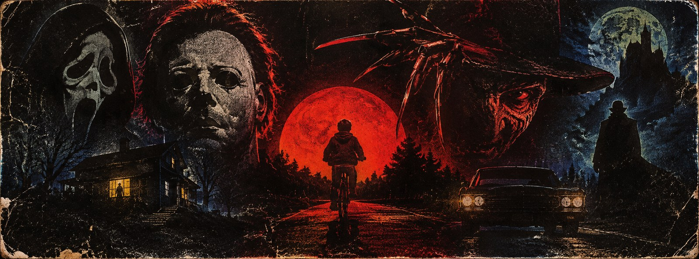
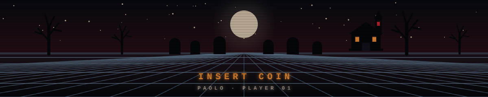

<div align="center">



<br>

<a href="https://github.com/Paolo-x">
  
</a>

<br>


</div>

<table>
<tr>
<td width="55%" valign="top">

### ▌ SYSTEM LOG

```text
> whoami
  paolo · computer engineering student

> now_playing
  python · java · kotlin · sql

> next_level
  loading...
```

</td>
<td width="45%" valign="middle" align="center">



</td>
</tr>
</table>

<div align="center">


### ▌ SELECT YOUR CLASS


<br><br>


<br><br>


### ▌ HIGH SCORES


<br>


<br><br>



</div>
